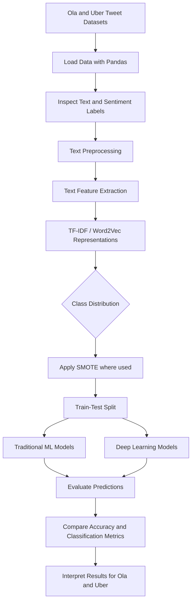

<div align="center">

# A Comparative Study of ML and DL Approaches for Twitter Sentiment Classification

**Sentiment analysis of customer tweets about Ola and Uber using Machine Learning and Deep Learning**

[](https://ieeexplore.ieee.org/abstract/document/10738938/)
[](https://www.python.org/)
[](https://jupyter.org/)

**Published Research Paper · NLP · Machine Learning · Deep Learning**

</div>

---

## 📄 Published Research

This repository contains the datasets and Jupyter notebooks associated with a comparative sentiment-analysis study of tweets related to **Ola and Uber**.

**Read the published paper:** [IEEE Xplore — Research Paper](https://ieeexplore.ieee.org/abstract/document/10738938/)

> Please use the IEEE Xplore page as the authoritative source for the paper's official title, author list, publication venue, and citation details.

## 🎯 Project Overview

Social-media posts provide useful signals about customer experiences, service quality, complaints, and satisfaction. This project applies Natural Language Processing (NLP), traditional Machine Learning (ML), and Deep Learning (DL) methods to tweet text associated with Ola and Uber and predicts sentiment categories.

The project compares multiple modelling approaches and explores text representation and class balancing. It is intended as a reproducible research and learning resource; reported scores should be interpreted in the context of the supplied datasets, preprocessing, and train/test setup.

## 🧭 Workflow



## 📁 Repository Structure

```text
.
├── Deep_Learning_OlaUber.ipynb   # Deep-learning experiments for Ola and Uber
├── ML_Algorithms_For_Ola.ipynb   # Traditional ML experiments for Ola
├── Ola_Category_3000.csv         # Ola tweet text and category labels
├── Uber_Category_3000.csv        # Uber tweet text and category labels
└── README.md                     # Project documentation
```

## 🗂️ Dataset

Two CSV files are included:

| File | Rows in supplied file | Columns |
|---|---:|---|
| `Ola_Category_3000.csv` | 2,999 | `Tweets`, `Category` |
| `Uber_Category_3000.csv` | 2,999 | `Tweets`, `Category` |

- `Tweets`: tweet text used as the input feature.
- `Category`: sentiment/category label used as the target.

The CSVs contain approximately 3,000 records each, as reflected in their filenames. Check the notebooks and dataset documentation before interpreting the numeric category labels as specific sentiment names; this README does not assume a mapping that is not explicitly documented in the files.

## 🧪 Methods and Models

### Text representation and preparation
- **TF-IDF** vectorization to represent the importance of words in tweet text.
- **Word2Vec** embeddings are explored in the traditional ML notebook.
- **SMOTE** is used in the deep-learning workflow to address class imbalance after vectorization.
- Train/test splitting and evaluation using classification metrics and confusion matrices.

### Traditional Machine Learning
The notebooks include experiments with models such as:
- Logistic Regression
- Naive Bayes
- Random Forest
- Support Vector Machine (SVM)
- XGBoost

### Deep Learning
The deep-learning notebook includes neural-network experiments using TensorFlow/Keras, including a **Feedforward Neural Network (FNN)** and additional neural-network experiments in the notebook.

## 📊 Results and Reproducibility

The saved notebook outputs include the following scores. These are **not a guarantee of generalisation** and should be revalidated by running the notebooks from a clean environment.

| Experiment (as labelled in notebook output) | Recorded score |
|---|---:|
| Ola — FNN test accuracy | 92.16% |
| Uber — FNN test accuracy | 98.82% |
| Ola — XGBoost classifier accuracy | 86.20% |
| Ola — SVM classifier accuracy | 78.80% |
| Ola — mean cross-validation accuracy | 79.00% |

**Important interpretation note:** These values come from saved notebook outputs and may correspond to different preprocessing, feature representations, or evaluation splits. Do not compare them as a strict head-to-head benchmark unless the same split strategy, feature pipeline, and evaluation protocol are used for every model. Re-run the experiments to confirm the scores.

## ⚙️ Installation

Python 3.x is recommended. Create a virtual environment before installing dependencies.

```bash
# Clone your repository (replace with your GitHub URL)
git clone https://github.com/<YOUR-USERNAME>/<YOUR-REPOSITORY>.git
cd <YOUR-REPOSITORY>

# Create a virtual environment
python -m venv .venv

# Activate on Windows PowerShell
.venv\Scripts\Activate.ps1

# Activate on macOS/Linux
# source .venv/bin/activate

# Install the main libraries used in the notebooks
python -m pip install --upgrade pip
pip install pandas numpy scikit-learn imbalanced-learn matplotlib seaborn nltk gensim tensorflow xgboost jupyter
```

Some notebook cells may require additional NLTK resources or a pretrained Word2Vec file. Follow the relevant notebook cell instructions and obtain any pretrained model from its official source; do not commit large external model files unless licensing permits it.

## ▶️ Run the Notebooks

1. Clone/download the repository and install the dependencies.
2. Keep both CSV files in the same directory as the notebooks, or update the notebook file paths.
3. Launch Jupyter:

   ```bash
   jupyter notebook
   ```

4. Open `ML_Algorithms_For_Ola.ipynb` for the traditional ML experiments.
5. Open `Deep_Learning_OlaUber.ipynb` for the Ola/Uber deep-learning experiments.
6. Run cells in order and review the printed metrics, classification reports, and plots.

You can also open the deep-learning notebook in Google Colab using the notebook's embedded Colab badge, after uploading or making the required files accessible to the runtime.

## 🔬 Research Questions

This project explores questions such as:

- How do traditional ML and deep-learning approaches perform on the supplied Ola and Uber tweet datasets?
- How does text representation (including TF-IDF and Word2Vec) affect classification?
- How does class balancing influence model training and evaluation?
- What do the evaluation metrics suggest about using social-media sentiment for customer-experience analysis?

## ⚠️ Limitations

- The supplied datasets are finite snapshots and may not represent all customers or current service quality.
- Category-label meaning should be verified from the original dataset preparation.
- Results can vary with random seeds, preprocessing, data leakage, class balancing, and train/test split choices.
- Applying SMOTE before splitting data can leak information across train and test sets. For a rigorous benchmark, split first and apply resampling **only to the training data**, ideally inside an `imblearn` pipeline.
- Accuracy alone may be insufficient for imbalanced data; also inspect precision, recall, F1-score, per-class performance, and confusion matrices.
- The experiments should not be interpreted as evidence of causation or as a complete measure of customer satisfaction.

## 🚀 Potential Improvements

- Use a stratified train/test split and a consistent evaluation protocol for every model.
- Apply SMOTE only to training folds to avoid leakage.
- Report precision, recall, macro-F1, weighted-F1, and confusion matrices for all models.
- Add a single script or pipeline for repeatable preprocessing and evaluation.
- Record package versions, random seeds, and experiment configurations.
- Evaluate on a separate, unseen dataset to test generalisation.

## 📚 Citation

Please cite the published work using the bibliographic details listed on IEEE Xplore:

**IEEE Xplore paper:** https://ieeexplore.ieee.org/abstract/document/10738938/

If you use the code or datasets, please also link to this repository. Verify the official citation details on IEEE Xplore rather than relying on an automatically generated citation.

## 👤 Author

**Md Aamir**

- Research area: NLP, Sentiment Analysis, Machine Learning, and Deep Learning
- Published paper: [View on IEEE Xplore](https://ieeexplore.ieee.org/abstract/document/10738938/)

## 📜 License

No license is specified in the supplied files. Add a license only after deciding how you want others to use, modify, and redistribute this repository. If the datasets originate from a third party, confirm their redistribution terms before publishing them publicly.

---

<div align="center">

**If this research is useful, consider starring the repository and citing the published paper.**

</div>
